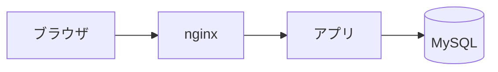

import icon from './icon.png';

# 自己紹介

<Columns ratio="2:1" align="center">
  <div>
    - とぴ
    - Webエンジニア
    - ISUCONに出ました
  </div>
  <Image src={icon} alt="とぴのアイコン" width={280} />
</Columns>

---

{/* layout: section */}

# 第1章 レイアウト

---

# default レイアウト

- 見出しと箇条書き
  - ネストもできる
- **強調** や `inline code`、[リンク](https://topi-log.com)

> 引用もこんな感じ

---

# コード

```ts
export function hello(name: string) {
  return `Hello, ${name}!`;
}
```

---

{/* layout: center */}

一言だけ大きく見せたいとき

---

{/* layout: image */}


---

{/* layout: section */}

# 第2章 部品

---

# Box と Columns

<Columns ratio="1:1:1" gap={24}>
  <Box title="sky">デフォルトの色</Box>
  <Box title="amber" color="amber">注意したいこと</Box>
  <Box title="rose" color="rose">ダメだったこと</Box>
</Columns>

---

# Place で自由配置

<Place x={120} y={260} w={360}>
  <Box title="ここ" color="emerald">x=120, y=260</Box>
</Place>

<Place x={720} y={380} rotate={-8}>
  <svg width="320" height="200" viewBox="0 0 320 200">
    <rect x="10" y="10" width="300" height="180" rx="24" fill="#e0f2fe" stroke="#38bdf8" stroke-width="6" />
    <text x="160" y="112" text-anchor="middle" font-size="36" fill="#0369a1" font-weight="700">インラインSVG</text>
  </svg>
</Place>

<div class="absolute right-[88px] top-[200px] text-2xl text-rose-500 font-bold">Tailwind も使える</div>

---

# Mermaid



---

{/* layout: end */}

# ありがとうございました

https://topi-log.com
